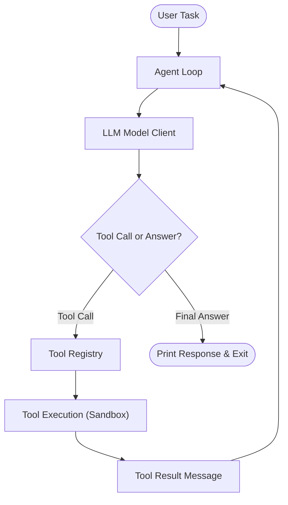

# CoyoteCode

CoyoteCode is a beginner-friendly TypeScript workshop project for building a terminal coding agent (like Claude Code, Antigravity, or OpenCode). 

Students learn how tool calling, workspace sandboxing, and the core agent loop work under the hood.



## Prerequisites

- Node.js **20.x or higher** (`node -v`)
- npm (included with Node.js)
- Git

## 1. Install and verify

Clone the repository and install dependencies:

```bash
git clone https://github.com/JacobAdams54/CoyoteCode.git
cd CoyoteCode
npm install
```

Run the offline checks (these verify types and logic without needing an API key):

```bash
npm run check
npm test
```

- `npm run check` runs the TypeScript compiler (`tsc --noEmit`).
- `npm test` runs the Vitest test suite once.
- `npm run test:watch` runs tests in watch mode during development.

## 2. Run the live coding agent

The demo connects to Google's Gemini API (default) or any local OpenAI-compatible endpoint (LM Studio / Ollama).

1. Copy the example configuration:

   ```bash
   cp .env.example .env
   ```

2. Add your free Gemini API key to `.env` (get one at [aistudio.google.com](https://aistudio.google.com/)):

   ```env
   GEMINI_API_KEY=your_key_here
   ```

   *(Optional: To run offline with local models, set `AI_PROVIDER=lmstudio` instead.)*

3. Run the agent:

   ```bash
   npm run dev
   ```

   To give the agent a custom task:

   ```bash
   npm run dev -- "List the files inside src."
   ```

## Available commands

| Command | Purpose | Network / API key required |
| :--- | :--- | :--- |
| `npm run check` | Type-check project with TypeScript | No |
| `npm test` | Run fast offline test suite | No |
| `npm run test:watch` | Run tests in interactive watch mode | No |
| `npm run dev` | Run the live coding agent | Yes |

## Project Structure

```text
src/
├── types.ts    # Core data contracts: ToolDefinition, ToolCall, Message, ModelClient
├── tools.ts    # ToolRegistry, file tools, and safePath sandboxing
├── model.ts    # OpenAI SDK client configured for Google Gemini & Local LLMs
├── agent.ts    # The core Sense → Plan → Act while-loop
└── index.ts    # Application entry point & CLI trace runner
```

### Workspace tools

The agent currently has four workspace-scoped tools:

- `list_files` lists files and directories inside a relative workspace path.
- `create_files` creates a file inside a relative workspace directory.
- `read_files` reads the UTF-8 contents of a file inside the workspace.
- `get_file_metadata` returns a file or directory's type, size, and modification time without reading its contents.

All file paths are checked with `safePath`, so paths that resolve outside the configured workspace are rejected.
