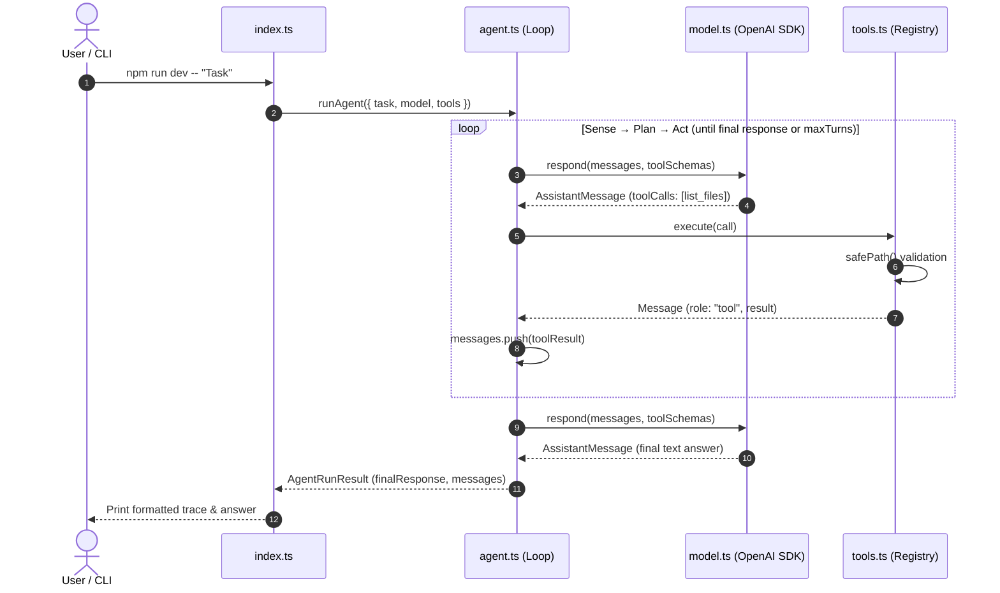

# CoyoteCode: Code Map

This map explains the responsibilities of each module and traces how one agent execution flows through the codebase.



## Module Responsibilities

### [`src/types.ts`](../src/types.ts): Core Data Contracts
- Defines the industry-standard agent interfaces: `ToolDefinition`, `ToolCall`, `ToolSummary`, `Message` (`user` | `assistant` | `tool`), and `ModelClient`.
- Students can open this single file to see the shape of the entire system.

### [`src/index.ts`](../src/index.ts): Application Entry Point
- Reads CLI arguments, initializes the `ToolRegistry` with `sample-project` as the workspace, builds the model client, and starts `runAgent()`.
- Prints the formatted trace (`[USER]`, `[ASSISTANT → TOOL]`, `[TOOL → ASSISTANT]`, `[ASSISTANT]`).

### [`src/agent.ts`](../src/agent.ts): Orchestration Loop
- Implements the core `while` loop:
  1. Ask `model.respond(messages, tools.list())`.
  2. If no tool calls, return `finalResponse`.
  3. If tool calls exist, execute each via `tools.execute(call)` and append to `messages`.
  4. Repeat until done or `maxTurns` is reached.

### [`src/tools.ts`](../src/tools.ts): Tool Registry and Sandboxing
- **`ToolRegistry`**: The application's security boundary. Models can only execute tools registered here. Converts exceptions into clean JSON error results.
- **`safePath`**: 5-line containment helper ensuring all file access stays inside the workspace.
- **`createListFilesTool`**: Lists entries in a directory inside the workspace.

### [`src/model.ts`](../src/model.ts): Model Client & Factory
- Implements `ModelClient` using the official `openai` SDK.
- Connects seamlessly to:
  - **Google Gemini (Default)**: via Google's official OpenAI-compatible endpoint.
  - **Local LLMs / LM Studio**: via `AI_PROVIDER=lmstudio`.

## Adding a New Tool

1. In [`src/tools.ts`](../src/tools.ts), define a function returning `ToolDefinition`:
   ```ts
   export function createMyTool(workspaceRoot: string): ToolDefinition {
     return {
       name: "my_tool",
       description: "What the tool does",
       parameters: {
         type: "object",
         properties: { param1: { type: "string" } },
         required: ["param1"],
       },
       async execute(args) {
         // Perform work safely using safePath(workspaceRoot, ...)
         return { success: true };
       },
     };
   }
   ```
2. In [`src/index.ts`](../src/index.ts), register it:
   ```ts
   tools.register(createMyTool(workspaceRoot));
   ```
3. The agent loop and model client will automatically expose it to the LLM and dispatch calls.
